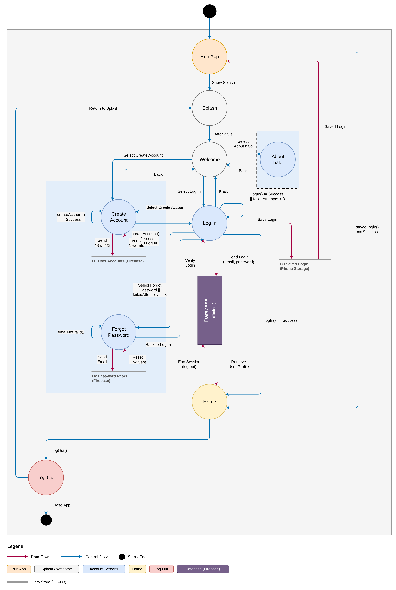
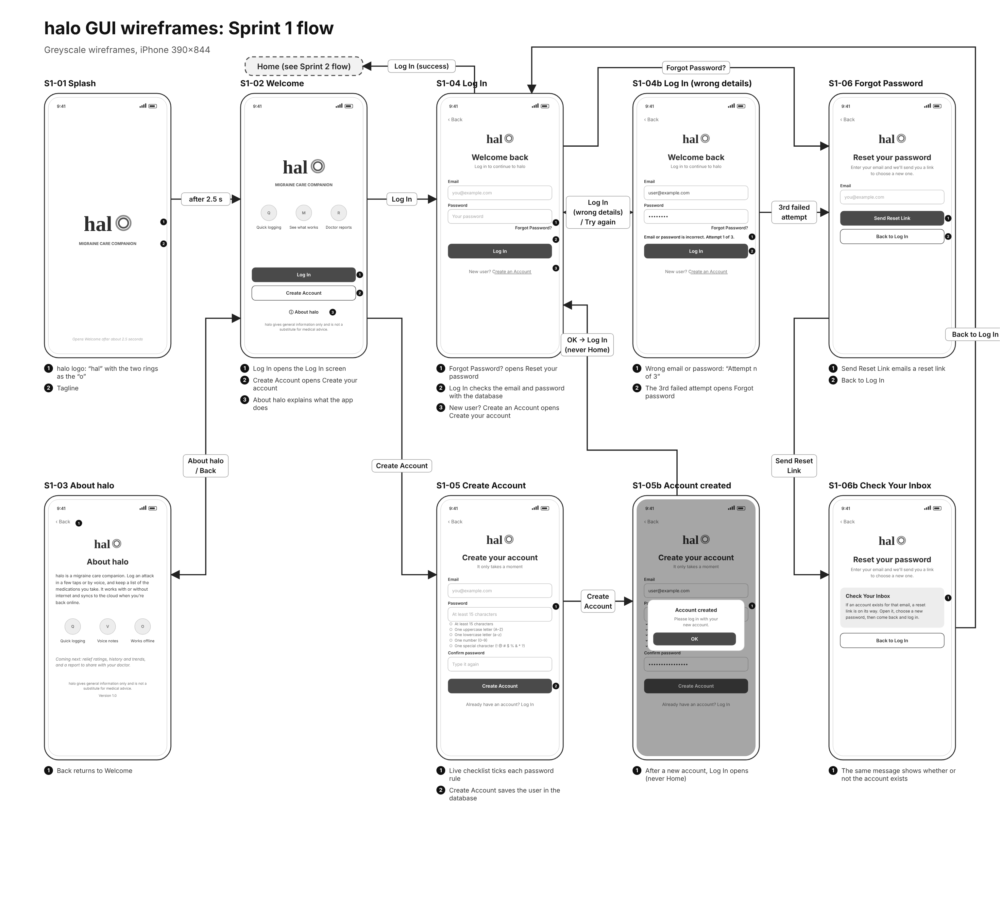

# halo: Sprint 1 report

**Sprint goal:** the front door of the app, meaning the Splash, Welcome and About halo screens, plus user accounts (Create Account, Log In, Forgot Password).
**Result:** every planned item was built, run on a real iPhone and tested.
**Video:** [Sprint 1 review on YouTube](YOUTUBE_LINK)

Contents:
1. [Deliverables](#1-deliverables)
2. [Comparison chart: implemented vs planned](#2-comparison-chart-implemented-vs-planned)
3. [Design diagrams (draw.io)](#3-design-diagrams-drawio)
4. [UI designs (Figma)](#4-ui-designs-figma)
5. [Implementation and testing](#5-implementation-and-testing)
6. [Feedback decision log](#6-feedback-decision-log)
7. [Agile review](#7-agile-review)

---

## 1. Deliverables

| Required for Sprint 1 | Status |
|---|---|
| Welcome screen, with an About halo page | ✅ Done |
| Create Account (sign up) | ✅ Done |
| Log In, connected to the database | ✅ Done |
| Forgot Password | ✅ Done |

| Extra work completed from the backlog | Status |
|---|---|
| Splash screen when the app opens (about 2.5 s) | ✅ Done |
| Home screen with Log Out | ✅ Done |
| Stays logged in after the app is closed | ✅ Done |
| User profile saved in Cloud Firestore | ✅ Done |
| Each person can see only their own data (security rules) | ✅ Done |
| Strong password rule (15+ characters, upper, lower, number, symbol) with a live checklist | ✅ Done |
| Log in limited to 3 attempts; the 3rd failure opens Forgot Password | ✅ Done |

## 2. Comparison chart: implemented vs planned

Partial = present in a limited or paid-only form.

**Implemented in Sprint 1 (working in the app today)**

| Feature | Migraine Buddy | Bearable | N1-Headache | halo |
|---|---|---|---|---|
| Secure account: Create Account, Log In, Forgot Password | ✅ | ✅ | ✅ | ✅ Implemented |
| Stays logged in; each person sees only their own data | ✅ | ✅ | ✅ | ✅ Implemented |

**Planned (not built yet)**

| Feature | Migraine Buddy | Bearable | N1-Headache | halo |
|---|---|---|---|---|
| Voice logging | ❌ | Partial | ❌ | Planned |
| Relief rated after the attack ends | ❌ | ❌ | ❌ | Planned |
| Report for the neurologist | ❌ | ❌ | ❌ | Planned |
| AI treatment insight | ❌ | ❌ | ❌ | Planned |
| Symptom question companion | ✅ | Partial | ✅ | Planned |
| Preventative pattern alerts | Partial | ❌ | Partial | Planned |
| Companion website | ✅ | ✅ | ✅ | Planned |

## 3. Design diagrams (draw.io)

The editable source for all diagrams is [`diagrams/halo_Sprint1_Diagrams.drawio`](diagrams/halo_Sprint1_Diagrams.drawio) (open it at [app.diagrams.net](https://app.diagrams.net)). The diagrams cover only what is built: Splash → Welcome (About halo) → Log In / Create Account / Forgot Password → Home.

| Diagram | Image |
|---|---|
| Colour key | [0_Colour_Key.png](diagrams/0_Colour_Key.png) |
| Use case | [1a_Use_Case_Log_In_and_Create_Account.png](diagrams/1a_Use_Case_Log_In_and_Create_Account.png) |
| Log In sequence | [2a_Log_In_Sequence.png](diagrams/2a_Log_In_Sequence.png) |
| Create Account sequence | [2b_Create_Account_Sequence.png](diagrams/2b_Create_Account_Sequence.png) |
| Forgot Password sequence | [2c_Forgot_Password_Sequence.png](diagrams/2c_Forgot_Password_Sequence.png) |
| Hierarchical task analysis: Run App to Welcome | [3a_HTA_Run_App_to_Welcome.png](diagrams/3a_HTA_Run_App_to_Welcome.png) |
| Hierarchical task analysis: Log In | [3b_HTA_Log_In.png](diagrams/3b_HTA_Log_In.png) |
| Data & control flow | [DCF_Run_App_to_Home.png](diagrams/DCF_Run_App_to_Home.png) |
| Data flow | [Data_Flow_Run_App_to_Home.png](diagrams/Data_Flow_Run_App_to_Home.png) |
| Control flow | [Control_Flow_Run_App_to_Home.png](diagrams/Control_Flow_Run_App_to_Home.png) |
| Finite state machine, Level 0 | [FSM_Level_0_Run_App_to_Home.png](diagrams/FSM_Level_0_Run_App_to_Home.png) |
| Finite state machine, Level 1: Log In | [FSM_L1_Log_In.png](diagrams/FSM_L1_Log_In.png) |

## 4. UI designs (Figma)

- Flow of all Sprint 1 screens: [PDF](ui/halo_Sprint1_Wireframe_Flow.pdf) · [PNG](ui/halo_Sprint1_Wireframe_Flow.png) · [SVG for Figma](ui/halo_Sprint1_Wireframe_Flow.svg)
- Each screen as PNG and SVG (drag an SVG into Figma to edit it): [`ui/screens`](ui/screens)

**Planned design vs what was built.** Five text cards on Welcome became three icons, because the first version looked crowded. Colours and the logo now come from the halo brand files. About halo became a link on Welcome, so logging in takes fewer taps.

## 5. Implementation and testing

| Requirement | Design | Screen | Implementation | Test result |
|---|---|---|---|---|
| Welcome and About halo | Use case, task analysis, control flow | Splash, Welcome, About halo | Three screens with navigation | Pass (10/12/2026) |
| Create Account | Create Account sequence, data flow | Create your account | Firebase Authentication, profile in Firestore | Pass (10/29/2026) |
| Log In, connected to the database | Log In sequence, FSM Level 1 | Welcome back | Firebase Authentication, saved log in | Pass (10/12/2026) |
| Forgot Password | Forgot Password sequence | Reset your password | Firebase reset email | Pass (10/29/2026) |

The full test log is in [test-log.md](test-log.md).

## 6. Feedback decision log

The decision for every review comment is in [feedback-log.md](feedback-log.md).

## 7. Agile review

**Problems encountered**
- Newer Expo Go requires signing in to an Expo account on the phone.
- Some Wi-Fi networks block the phone from reaching the laptop, so the demo uses `npx expo start --tunnel`.
- Firestore blocks everything by default, so security rules had to be written first.

**Changes made after feedback**
- The roadmap shows a deliverable for every sprint, and a Future Work section was added.
- The password rule was raised to 15+ characters with uppercase, lowercase, number and special character.
- After the 10/19 review: new logo, "halo" in lowercase everywhere, Create Account opens Log In, and log in is limited to 3 attempts.

**Known issues and remaining work**
- New accounts are not asked to verify their email address yet.
- The reset email can land in spam, so the screen tells people to check their spam folder.
- No automated tests yet (planned for Sprint 4).
